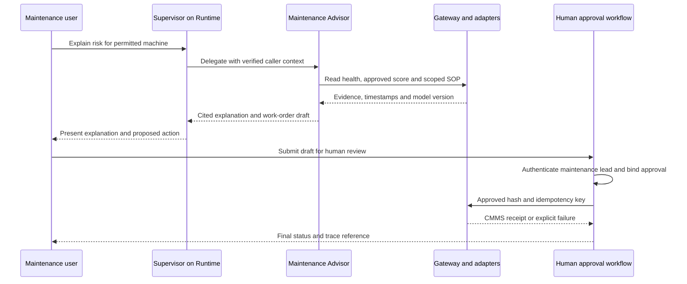

# AeroForge Part 1 Agent Design Specification

**Contributor:** Wali, AI Agents and Ontology  
**Status:** Draft for team review; enterprise design, not deployed  
**Date:** 2026-11-11  
**Companion:** [Umar's ML specification](AeroForge_ML_Spec.md)

## Purpose and architecture

Provide four agents that answer operational and finance questions using authorized evidence. Application-defined orchestration runs on Amazon Bedrock AgentCore Runtime. Gateway exposes controlled tools; Identity handles supported credentials; Memory retains scoped conversation context; Observability traces execution. AgentCore hosts the application; it does not automatically supply these four business agents or their authorization policies. [1–3]

The Supervisor delegates to Maintenance Advisor, Variance Analyst, and Supply & Cost. Agents consume Umar's approved risk scores, anomaly outputs, energy forecasts and variance calculations. They do not train these models. Critical alarms retain a separate deterministic streaming path; LLM latency must not gate the under-60-second alert requirement.

The pilot uses commercial Wichita, Oklahoma City and approved Querétaro data, with plant-scoped access and headroom for twelve plants. Tool names below are proposed contracts because the Data Pack and final schemas are pending. TALON and Mexico payroll/HR are excluded from the shared deployment, including prompts, documents, memory and traces. Future restricted agents require separately approved accounts, regions, models, identities and stores. These technical proposals do not establish legal compliance.

## Models and agent responsibilities

Select **Anthropic Claude Sonnet 4.5 on Amazon Bedrock** as the initial pinned candidate for all four agents, consistent with the diagram's Claude selection. Model ID: `anthropic.claude-sonnet-4-5-20250929-v1:0`. Verify account access, supported invocation mode and regional policy against the model card. A US inference profile is not a single-region endpoint: every destination must satisfy the account allow-list. Disable invocation if this check fails; do not silently fall back to global inference. [4]

One version simplifies pilot evaluation and regression testing. The trade-off is higher routing cost than a smaller model. Benchmark a cheaper supported model using the same held-out tests before changing this choice. Version prompts and tool schemas, use conservative generation parameters, and cap output/context. This is a candidate selection, not a measured performance claim.

| Agent | Purpose and tools | Knowledge and memory | Human decision |
|---|---|---|---|
| Supervisor, AeroForge Copilot | Classify intent, delegate authorized tasks, merge cited answers; `delegate_task`, `get_request_status` | Approved glossary and tool catalog; request/session context | Cannot approve actions; escalates conflicting evidence |
| Maintenance Advisor | Explain health, approved failure/scrap risk and SOPs; `get_machine_health`, `get_risk_scores`, `search_maintenance_docs`, `draft_work_order` | Approved SOPs and sanitized CMMS notes; scoped machine/work-order references | Maintenance lead approves submission; no machine actuation or safety override |
| Variance Analyst | Explain actual minus budget, reconciled drivers and energy outlook; `get_finance_variance`, `get_variance_drivers`, `get_energy_forecast` | Finance definitions and close procedures; period/snapshot references | Controller approves official commentary; no journal posting or budget changes |
| Supply & Cost | Explain PPV, supplier trends and material exposure; `get_purchase_price_variance`, `get_supplier_summary`, `get_market_context` | Approved procurement policies/contracts and dated commodity/FX context; scoped supplier/material references | Buyer/controller approves decisions; no PO release or master-data changes |

## Tool contracts and grounding

Expose narrow MCP tools through AgentCore Gateway with Lambda adapters. Do not expose unrestricted SQL, arbitrary AWS APIs, a shell or general web browsing. Implement the diagram's text-to-SQL flow as structured query intent mapped by the backend to approved parameterized SQL templates through the Redshift Data API. This preserves natural-language access while constraining tables, joins, operations and cost. [2]

| Tool family | Inputs | Backend and returned evidence |
|---|---|---|
| Health and ML | Machine ID, as-of time | Authorized DynamoDB health lookup and approved score store; observation time, score/horizon, model version, freshness and missing-data flag |
| Finance and energy | Plant, period, account/category, close version | Governed Redshift views over gold; actual, budget, variance, currency, approved drivers/residual, forecast version, query and snapshot references |
| Purchasing | Plant, supplier/material, period | Approved AP/procurement views; quantities, actual/standard unit costs, PPV, currency, FX date and record references |
| Document retrieval | Query and permitted scope | Bedrock Knowledge Bases; document ID, revision, URI, passage, classification and retrieval time |
| Work-order draft | Machine, priority, cited evidence | Draft payload and content hash; no CMMS action until separate approval |

Adapters derive permission from validated caller context, never model-supplied role or plant claims. Reject unauthorized IDs before retrieving rows. Enforce input validation, result limits, timeouts and relation/operation allow-lists. Return distinct denial, stale-data, missing-data and backend-failure responses; these must never become zero-valued finance results.

Backend SQL performs all official calculations and conversions using approved definitions. Avoid double-counting downtime or scrap already reflected in ledger variance. Show unexplained residuals and describe statistical associations without claiming causation. Agents summarize tool results, with units, reporting cutoff, freshness and evidence references; they do not invent accounting totals.

## Knowledge bases and memory

Use Bedrock Knowledge Bases with the diagram's OpenSearch Serverless vector store for approved commercial SOPs and sanitized repair notes. Separate maintenance and finance/procurement collections and permissions. Check owner, approval, revision, plant, classification and effective date at ingestion; remove superseded passages from active retrieval. Start with Titan Text Embeddings V2, subject to regional validation, and version embedding/chunking configuration. Numeric finance truth comes from query tools rather than embeddings. [5]

Authorize before retrieval and before passages enter the prompt. Apply backend-generated plant/domain filters that the user and LLM cannot widen, alongside IAM and store permissions. Keep TALON and Mexico personal data out of the shared index; metadata filters alone are insufficient isolation.

Use AgentCore short-term Memory for sanitized history scoped by validated actor and session IDs. Proposed expiry: seven days, pending security-owner approval. Retain source pointers rather than full finance result sets. Disable long-term extracted memory for the pilot to reduce confidential and inaccurate persistence. If enabled later, permit only approved preferences with expiry/deletion controls. Recheck current entitlements on memory retrieval; remembered approval is never authorization. Retain required audit evidence separately. [6]

## Identity and access flow

1. Authenticate workforce users through approved enterprise SSO federation with MFA. Obtain a supported OIDC token for Runtime and validate issuer, audience, signature and expiry. Bind it to a server-generated session and authoritative entitlement lookup.
2. Give Supervisor and specialists distinct least-privilege execution roles. Pass verified caller context through delegation; prompt text cannot assert identity or permissions.
3. Gateway and adapters authorize each action/resource. AgentCore Identity handles supported outbound credentials, such as scoped CMMS OAuth, but does not automatically propagate the user's database/Lake Formation permissions. [3]
4. Initially map validated entitlements to restricted database roles and approved views/templates. Deny direct base-table access and cross-plant requests. IAM, Lake Formation and database policies each protect their own layer. Test their actual integration before claiming end-to-end identity propagation.
5. Rotate supported stored credentials; encrypt stores with KMS and use TLS. Restrict egress and use private connectivity where supported. Fail closed if the authorized endpoint or data path is unavailable.

Replace blanket identity-propagation wording in the logical/network diagrams with this flow. A self-asserted `isUSPerson` tag cannot establish TALON eligibility. Mexico personal records must never enter the shared US service, even through logs or repair notes; only approved de-identified exports under ADR-002 are available. Confirm inference-profile destinations against the diagrams' region restrictions with Luke.

## Guardrails and human approval

Apply versioned Bedrock Guardrails to user input and output for harmful content, denied topics and sensitive-information handling; use supported injection/grounding checks as additional controls. Treat retrieved documents and tool outputs as untrusted data, never instructions to change permissions or system policy. Guardrails supplement backend authorization and accounting controls. [7]

Require current SOP citations for maintenance recommendations and query evidence for financial claims. Missing, stale, conflicting or inaccessible evidence triggers a bounded response and escalation. Enforce proposed limits of two delegation levels, ten tool calls and 60 seconds total per interactive request. Allow at most one bounded retry of transient reads; never blindly retry writes.

The AI Supervisor routes tasks. An authenticated **human maintenance lead** approves work orders. Step Functions records the immutable draft hash, evidence, requester, authorized approver and expiry. The approval UI binds approval to that exact payload. A separate write adapter revalidates permission and approval, then submits to CMMS with an idempotency key. Alteration, denial, expiry or duplicate submission cannot create a new work order. Controller review similarly gates official finance commentary; no automatic journal-posting tool exists.

Capture redacted trace IDs, tool/prompt/model versions, requester/approver IDs, timestamps, decisions and outcomes. DynamoDB is the workflow ledger; Streams alone do not make it immutable. Archive required evidence to restricted S3 Object Lock storage under the team's approved retention policy. Avoid raw tokens, personal information and unrestricted prompt logging.

## Example sequence

A cross-plant request fails at the adapter before records reach the model. Critical alarms continue through the independent streaming alert path regardless of agent availability.

## Evaluation and operations

Proposed reviewers: Wali owns agent tests and versioning; Umar checks score interpretation; Neha checks finance grain/joins; Luke checks permissions and audit; the team lead checks diagram consistency. Confirm these assignments with the team.

Create 120 versioned cases: 25 maintenance, 25 finance, 20 supply, 20 authorization/privacy and 30 injection, stale-data, failure and approval cases. Cover all pilot plants and multi-step queries. Domain reviewers establish expected answers, evidence and allowed actions before execution. Separate development examples from held-out tests. Use synthetic fixtures until approved data arrives and label fixture results accordingly.

| Measure | Proposed release gate |
|---|---|
| Authorization and privacy | Zero successful unauthorized tool calls or disclosures in the test set, including cross-session memory and restricted documents |
| Approval and idempotency | All successful writes match valid approval; zero writes on denial/expiry or duplicate work orders |
| Accounting and evidence | All test totals/PPV match approved SQL within defined currency rounding; every numerical claim has evidence |
| Grounding and citations | At least 95% of factual claims supported on human review; all material maintenance advice cites current approved SOPs |
| Correct routing and task completion | At least 90% on held-out permitted tasks, reported by agent and plant |
| Failure/freshness handling | All injected stale/missing/unavailable cases disclose the condition without invented facts |
| Latency and cost | Read-only p95 target under 30 seconds; measure fully allocated cost per 1,000 questions |

Targets are not measured results. Track false refusals, unsafe advice, citation errors, token use, tool failures and query time. Human review must verify accounting and safety-sensitive responses; an LLM judge cannot certify authorization or correctness. Run regression tests for model, prompt, policy, schema and knowledge changes; canary new versions and roll back on critical-control failure. Use redacted traces and sampled feedback. [8]

## Cost per 1000 questions

**USD planning estimate prepared 2026-11-11; not a measured bill or Calculator quote.** One question is one completed user request including every internal delegation, tool/model call and retry. Assume three model calls with combined 12,000 input and 2,000 output tokens per question. The $3/$15 per million token rates are planning inputs based on the provider's published Sonnet 4.5 baseline; Luke must confirm selected Bedrock region/mode pricing. No caching or batch discount is assumed. [9–10]

| Component | Assumption per 1,000 questions | Cost |
|---|---|---:|
| Model input | 12M tokens at $3/M | $36.00 |
| Model output | 2M tokens at $15/M | $30.00 |
| Runtime v2 CPU | 10 active vCPU-seconds/question across agents at $0.1276/vCPU-hour | $0.35 |
| Runtime v2 memory | 1 GB for 60 aggregate session-seconds/question at $0.0169/GB-hour | $0.28 |
| Gateway | 10,000 total invocations at $0.005/1,000 | $0.05 |
| Short-term Memory | 0.02 GB ingested, 0.02 GB retrieved, 0.0047 GB-month retained at $1/GB, $0.20/GB and $0.10/GB-month | $0.02 |
| Other variable services | Unverified allowance for embeddings, guardrails, Lambda, approvals, logs and sampled evaluation; replace with itemized quote | $10.00 |
| **Variable subtotal** | Rounded total | **$76.71** |

AgentCore unit rates are from its current pricing table. Memory uses post-October-6 GB-based short-term pricing, not the former event-based rate. Runtime assumptions include initialization and billable idle memory across all agents; unclosed sessions can cost more. Long-term memory, browser and code interpreter are disabled. [11]

Fully allocated cost is **$76.71 + (monthly shared infrastructure allocation × 1,000 / monthly questions)**. Include incremental or assigned OpenSearch Serverless, Redshift, storage, network/private endpoints and monitoring cost. These are not free because BI also uses them. An illustrative $300/month shared allocation at 10,000 monthly questions adds $30: **about $107 per 1,000 questions**. At only 1,000 monthly questions the same allocation yields about $377. The $300 is an assumption, not a vendor quote. Initial indexing, evaluation campaigns and engineering need separate budgets; tax/support excluded.

At 10,000 monthly questions this illustrative allocation is about $1,067/month; at 40,000, about $3,368/month if fixed cost stays $300. Plant count does not determine question volume or capacity. Luke should replace assumptions for Scenario A/B and include the agent component once in the enterprise total. Doubling model token use adds $66 per 1,000 questions. Longer histories/retries must be counted.

Optimize by invoking only relevant specialists, bounding retrieved context, summarizing history, using SQL aggregates, closing sessions and enforcing user quotas. Consider a cheaper routing model and supported prompt caching only after regression tests; no savings are claimed here.

## Integration and open checks

- Wali and a teammate review the draft; no deployment, executed evaluations or measured results are claimed.
- Luke verifies model/AgentCore account access, regions, inference destinations, networking, quotas and actual prices. Prove denial behavior before real data access.
- Umar and Neha confirm score freshness, schemas, finance definitions and snapshot contracts when the Data Pack arrives.
- The team lead reconciles diagram claims about automatic identity propagation and DynamoDB immutability, and pins the model/inference mode.
- Confirm retention, action approvals and reviewer assignments with the team. If Part 3 cannot use Bedrock, demonstrate approved static scores and a simulated approval flow and document the simplification in Design vs Sandbox.

## Sources and AI assistance

Project context: repository logical/network diagrams, architecture summary, ADR-001/002/003/005 and Umar's ML draft. These contain proposed project constraints rather than vendor guarantees. Official sources were checked on 2026-11-11; account validation and execution tests remain pending.

1. [AgentCore overview](https://docs.aws.amazon.com/bedrock-agentcore/latest/devguide/)
2. [Gateway](https://docs.aws.amazon.com/bedrock-agentcore/latest/devguide/gateway.html)
3. [Identity](https://docs.aws.amazon.com/bedrock-agentcore/latest/devguide/identity.html)
4. [Sonnet 4.5 model card](https://docs.aws.amazon.com/bedrock/latest/userguide/model-card-anthropic-claude-sonnet-4-5.html)
5. [Knowledge Bases](https://docs.aws.amazon.com/bedrock/latest/userguide/knowledge-base.html)
6. [AgentCore Memory](https://docs.aws.amazon.com/bedrock-agentcore/latest/devguide/memory.html)
7. [Guardrails](https://docs.aws.amazon.com/bedrock/latest/userguide/guardrails.html)
8. [Observability](https://docs.aws.amazon.com/bedrock-agentcore/latest/devguide/observability.html)
9. [Provider baseline pricing](https://www.anthropic.com/news/claude-sonnet-4-5)
10. [Bedrock pricing](https://aws.amazon.com/bedrock/pricing/)
11. [AgentCore pricing](https://aws.amazon.com/bedrock/agentcore/pricing/)

AI assistance: ChatGPT helped draft this specification and revise ADR-001 using repository context and official documentation. Wali and a teammate must review the reasoning and assumptions. No implementation experience or measured performance is asserted.
